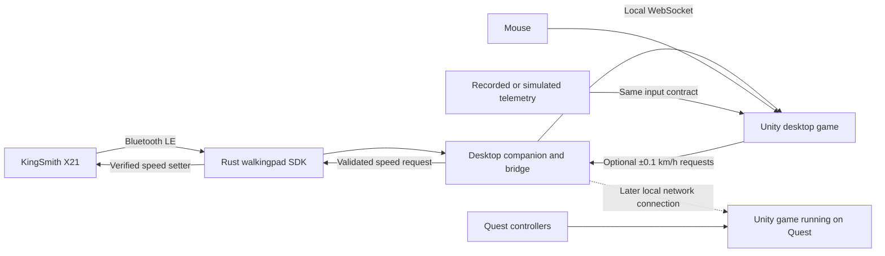

# Walkpadead architecture

## Product scope

Build two independently useful products: an open-source library that reads walking-pad telemetry and supports opt-in bounded speed adjustments, and a game that consumes that telemetry as movement input. Road bonuses use the optional control path. A future companion app gives the library a device picker, connection status, and live readings.

The first target combination is **KingSmith X21 → Bluetooth LE → macOS on M4 → desktop game with mouse aiming**. Design the same SDK for Windows, Linux, and Android/Quest, validating each platform separately. The Quest headset model remains to be selected.

The first game is a forward-moving survival shooter. Walking increases distance from a pursuing horde while approaching zombies become shooting targets. Sessions should work at a comfortable walking pace.

## Technology decisions

| Component | Recommendation | Reason |
| --- | --- | --- |
| Reusable device SDK | Rust | An engine-independent core with native platform builds and a small C interface when embedding becomes useful. |
| BLE transport | Evaluate and pin a released `btleplug` version | Its upstream platform matrix covers macOS, Windows, Linux, and Android. Android requires Java/JNI integration, which needs its own prototype. |
| Desktop companion | Rust backend with a minimal Tauri UI | Reuse the SDK and connection logic across desktop platforms. Limit the frontend to device selection and session status. |
| Initial game connection | Versioned JSON over a local WebSocket | The SDK and Unity can be developed and restarted independently. Recorded sessions can use the same interface. |
| Game | Unity 6 LTS, C#, URP, Input System, OpenXR | Share gameplay across a Mac desktop build and a later Quest Android build. Pin a compatible editor and package set at project setup. |
| Quest direct connection | Rust native library plus a C# wrapper and Android initialization layer | Reuse the protocol implementation inside the Quest app after the direct BLE feasibility test. |

These choices follow the published [btleplug platform support](https://github.com/deviceplug/btleplug#platform-status), [Tauri architecture](https://v2.tauri.app/start/), [Unity native plug-in interface](https://docs.unity.com/en-us/engine/6000.3/manual/programming-environment/plug-ins/native/overview), and [Meta's Unity/OpenXR setup](https://developers.meta.com/vr/documentation/unity/unity-tutorial-hello-world-manual-steps/). They do not establish compatibility with this particular X21.

**Rust versus Go:** either language can handle this small data stream. Prefer Rust because the intended endpoint includes an embedded Android/Unity library. Go remains a reasonable choice for a desktop-only service, but the [Go Bluetooth support matrix](https://github.com/tinygo-org/bluetooth#current-support) does not list Android. Performance is not the deciding factor; platform integration and reusable bindings are.

Use Python only if an existing driver makes the initial hardware investigation faster. The [ph4-walkingpad](https://github.com/ph4r05/ph4-walkingpad) and [walkingpad-controller](https://github.com/mcdax/walkingpad-controller) projects are useful references. Their support for other KingSmith models does not prove X21 support.

## X21 discovery and WalkingPad+

The model name alone does not settle the protocol. [Trot](https://github.com/marcuspuchalla/trot#supported-treadmills) lists X21 in an unsupported app-cipher family, while [BeltControl's protocol table](https://github.com/morsela/beltcontrol/blob/main/docs/protocols.md) lists X21 under both FTMS and a proprietary `0x1234` family. These are implementation reports, not a confirmed compatibility result for this unit.

The inspected unit is `KS-NACH-X21C`: service `00011234`, write-without-response `0001fed7`, notify `0001fed8`, and a handshake that selects the v5 alphabet. It is not FTMS. Live speed, run state, steps, and time have been observed; distance was absent. See [implementation status](implementation-status.md) for validation limits.

For other units, discover the actual GATT services and characteristics, then select a driver. Keep three candidate protocol families behind the same interface:

| Candidate | Identification evidence | Development priority |
| --- | --- | --- |
| KingSmith proprietary variant | A matching service/characteristic layout, potentially `0x1234`, and validated packet captures | Implement first if the user's X21 exposes it. |
| Legacy WiLink | Matching legacy services, often `0xFE00`, and validated status frames | Implement if observed on the X21; otherwise a later compatibility addition. |
| Fitness Machine Service | Service `0x1826`, treadmill characteristics, and valid feature/data packets | Use when the hardware actually exposes it; preserve any model-specific extensions. |

A name prefix is a discovery hint. Characteristic layout and valid responses determine the driver. Unknown layouts should return a useful diagnostic instead of sending speculative commands.

WalkingPad+ is installed at `/Applications/WalkingPad+.app`; its local bundle identifies version 1.0.8, build 10095, bundle ID `com.lolofit.walkingpad`, as an iPhoneOS app running on the Mac. A read-only UI observation showed a connected workout at 2.9 KPH, 0.07 km, 145 steps, and 4 calories. App-displayed values do not establish which fields come directly from the device. WalkingPad+ was later closed for SDK testing.

Use WalkingPad+ to compare displayed readings in separate sessions and to identify the device name. A documented live telemetry API could become an optional adapter if one is found. The SDK's primary connection should remain direct BLE. Existing KingSmith integrations report a single BLE client at a time, so plan to disconnect WalkingPad+ and KS Fit before SDK sessions, and verify the X21's behavior. [Connection behavior reference](https://github.com/mcdax/walkingpad-controller#connection-exclusivity).

## Connection architecture



The companion owns the BLE connection. It can serve multiple telemetry subscribers without making each subscriber connect to the pad. Run either the companion or the headless CLI bridge as the connection owner.

For the first Quest version, the game can run on the headset while the Mac forwards telemetry over Wi-Fi. This works as an architectural path without requiring the Mac to render PC VR. A Windows gaming-PC/Link edition is a separate optional deployment; it is not a dependency of the Mac plan.

For a later fully standalone edition, the Quest app embeds the Rust SDK and connects directly to the pad. The Mac and its bridge are then unnecessary. The pad-to-host link is BLE in either arrangement; the bridge-to-game link is a separate application connection.

## SDK responsibilities

Use one public Rust library with internal modules initially. Split crates only where packaging requires it.

| Module | Responsibility |
| --- | --- |
| `transport` | BLE discovery, service enumeration, serialized GATT operations, notification subscription, disconnect events. |
| `protocol` | Driver selection, framing, checksums, status requests, units, optional fields, and verified vendor extensions. Pure parsing should work without Bluetooth. |
| `session` | Connection lifecycle, freshness, bounded retry/backoff, capabilities, and cancellation. |
| `telemetry` | Engine-neutral events, units, field provenance, counter resets, and versioned serialization. |
| `control` | Optional relative speed adjustments, bounds, duplicate detection, cooldown, and telemetry confirmation. |
| `replay` | Recorded packets and simulated telemetry for development without a treadmill. |

Expose operations equivalent to `scan`, `connect`, `capabilities`, `subscribe`, `refresh_status`, and `disconnect`. Emit connection, capability, telemetry, stale-data, and error events.

The bridge is **read-only by default**. The user has extended scope to road bonuses that change speed by ±0.1 km/h within **1.0–5.0 km/h**. An explicit bridge flag enables authenticated control requests, and the player enables bonuses in the game. Controls require fresh running-belt telemetry, a matching current speed/connection epoch, one request at a time, and a ten-second cooldown. A later report must confirm the target; uncertain writes lock that bridge session and are never retried automatically. Motor start/stop, mode changes, and speed restoration on reconnect remain outside the game API.

The SDK publishes the device's observations. The game integrates the reported speed directly and never substitutes a requested target for observed telemetry. Difficulty and player calibration belong in the game. Record packet timing and anonymize device identifiers in shared diagnostic fixtures.

## Telemetry contract

Normalize speed to metres per second, distance to metres, and duration to seconds. Keep the original unit conversion in the protocol driver. Unsupported or unobserved metrics are nullable, with explicit capabilities; zero is a real measurement.

| Field | Meaning |
| --- | --- |
| `schema_version`, `connection_id`, `sequence` | Contract version, connection epoch, and sample ordering. |
| `speed_mps`, `speed_semantics` | Device-reported speed and whether it represents measured speed, a target, or an unverified device value. |
| `distance_m`, `elapsed_s`, `steps` | Optional device session counters. Detect resets/wraps; keep game-session totals separately. |
| `belt_state`, `operating_mode` | Normalized values with an explicit unknown state. |
| `sample_age_ms` | Time since the underlying device report when the bridge sends the message. |
| `field_age_ms` | Ages of retained measurements; speed freshness is checked independently of other fields. |
| `quality` | Device observation, derived value, or simulated input. |
| Optional extension metrics | Incline, device-reported energy, heart rate, firmware, or status codes only when actually available. |

Illustrative payload, not a measurement from the user's X21:

```json
{
  "schema_version": 1,
  "connection_id": "example-session",
  "sequence": 42,
  "speed_mps": 0.833333,
  "speed_semantics": "device_reported_unverified",
  "distance_m": 1200,
  "elapsed_s": 1440,
  "steps": null,
  "belt_state": "running",
  "operating_mode": "unknown",
  "sample_age_ms": 0,
  "field_age_ms": { "speed_mps": 0, "distance_m": 0, "elapsed_s": 0 },
  "quality": "device_observation"
}
```

Capabilities describe both support and observed availability. Partial packets update only their fields; each retained field keeps its own age. An unrelated notification must not make old speed data fresh. Any estimated calories or cadence must be explicitly derived and separate from device readings.

Measure cadence on the X21. The legacy [ph4-walkingpad documentation](https://github.com/ph4r05/ph4-walkingpad#protocol-basics) describes status polling at approximately 750 ms; that is reference behavior, not an X21 guarantee. Render the game continuously between reports, without inventing additional physical samples.

Use monotonic clocks for local timeouts. For network consumers, combine transmitted field age with elapsed local receipt time, bound delivery queues to the newest sample, and detect a stalled link independently. Evaluate network delay before enabling the Quest bridge; do not compare monotonic timestamps from different machines. Heartbeats establish connection health and never refresh measurement age.

## Companion app and platform packaging

The first UI has a device picker, Connect/Disconnect, speed, available metrics, connection quality, and the age of the latest speed report. The game shows a short connection indicator and a path back to the companion when input is unavailable. Raw protocol details belong in diagnostics.

The bridge binds to loopback, uses a per-session token, and exposes `/telemetry` plus an optional authenticated `/control` endpoint when launched with `--allow-speed-control`. The first Quest development build reaches the same authenticated loopback endpoint through ADB reverse over USB. `scripts/quest.py` transfers the per-session connection file into the app’s private files directory; the C# parser continues to reject non-loopback URLs. Local-network sharing is a later explicit mode, with pairing, authenticated encrypted transport, and a visible connected-client list. It must not require a cloud account or expose a public internet service.

For macOS, build native `aarch64-apple-darwin` binaries and package the companion as an app bundle with a Bluetooth usage description. Test permissions in the packaged app as well as the development environment. Signing/notarization belongs to external distribution. These permission details are documented by [btleplug's macOS setup](https://github.com/deviceplug/btleplug#macos).

Windows and Linux use the same domain/protocol code with their platform BLE backends. A successful build is recorded separately from real-device validation. Bluetooth adapter behavior, permissions, reconnects, and suspend/resume need testing on each supported OS.

## Game architecture and movement

The game depends on a small `ITreadmillSource` abstraction, implemented by WebSocket, replay, simulator, and eventually native BLE adapters. A separate `IAimSource` supplies mouse or tracked-controller aim. Combat and enemies know neither Bluetooth nor the operating system.

Keep these gameplay systems separate: telemetry input, locomotion, aiming/weapons, enemies, encounter pacing, session state, and HUD. The desktop camera and Quest OpenXR rig share gameplay systems. `QuestControls` reads Input System actions, applies tracked head/controller poses before rendering, and supplies the same `IAimSource` used by the sidearm.

Convert speed using `metres_per_second = kilometres_per_hour / 3.6`. Start with one Unity unit per metre and a 1:1 movement gain. A pad reporting 3 km/h therefore advances the player about 0.833 m/s. Let users calibrate game movement later; report real and virtual distance separately when gain differs from one.

In manual operation, belt speed is the movement signal. Walking harder on a belt running at a fixed speed does not automatically provide a faster input signal. Verify whether the X21 reports a target or a measured value during acceleration and stopping. Do not infer that a moving belt proves a person is walking on it.

Desktop movement follows a fixed forward route; mouse movement aims the weapon. Per the updated Quest requirement, headset yaw steers virtual movement across a level extraction yard. Project the head forward vector onto the ground plane and normalize it before multiplying by reported speed. Looking up/down does not change speed or height; nearly vertical gaze retains the last valid heading. Controller aim is independent of locomotion. The controller uses OpenXR’s fused aim pose, including gyro tracking, rather than integrating raw angular velocity.

Integrate the latest fresh reported speed per simulation step, with no smoothing or speed floor. A fresh stopped state sets movement to zero immediately. On disconnect or stale speed, stop virtual movement and pause attacks/scoring; require fresh reports and an explicit resume. Use a 3-second stale threshold for the observed roughly 2-second X21 cadence; re-evaluate it for other firmware and longer sessions. A game pause does not stop the physical belt.

## First playable experience

Create a five-minute run with one route, one weapon, two enemy behaviors, a pursuing-horde distance indicator, and a finish screen. Walking creates progress. Approaching zombies can reduce health or pressure the pursuit meter if they are not shot. A distance target or extraction point ends the run.

Balance encounters around the player's chosen comfortable pace. Increase enemy density or aiming difficulty as difficulty rises. Optional road bonuses alternate +0.1 and −0.1 km/h, constrained by the player's 1.0–5.0 km/h range. They remain off until enabled and are disabled on input loss or an uncertain command. Include a simulator mode so the entire game can be developed or demonstrated without a connected pad.

Keep physical movement forward. The first VR design should not demand turning around, walking backward, jumping, ducking, or stepping sideways on the belt. Show rear pursuit through the HUD and sound. Before moving-belt VR trials, validate the setup against the X21 and headset instructions, preserve access to the physical stop mechanism, and test tracking loss and headset removal. Passthrough can support awareness but is not a guaranteed view or an emergency-stop mechanism.

## Quest integration

The current Quest build uses OpenXR 1.16.1 on Unity 6000.3.28f1, Android ARM64 IL2CPP and Vulkan, with Touch, Touch Plus and Touch Pro profiles. A world-space menu is operated by controller pointing and trigger; X starts/resumes, A reloads, B pauses, and Y toggles optional speed bonuses. Tracking loss, headset removal, focus loss and suspension pause the run. Buttons require release before a new press after interruption. Explicit offline simulation is available from the menu; failed live input never selects it automatically. Hardware validation and mobile profiling remain pending.

For a future direct-BLE edition, prove direct Bluetooth access with a small telemetry viewer before committing to a fully standalone game. Test discovery, permissions, protocol initialization, fresh telemetry, reconnection, and focus/suspend behavior on the actual headset.

Android BLE requires runtime permissions appropriate to the target OS. Meta currently places Bluetooth scan/connect permissions under review for supported third-party interoperability use cases. Store acceptance is a separate gate from a working development build. See [Android permissions](https://developer.android.com/develop/connectivity/bluetooth/bt-permissions) and [Meta's permission review rules](https://developers.meta.com/vr/resources/permissions-review-required/).

Package the SDK as an Android ARM64 native library with a narrow C ABI. Initialize the BLE backend through the app's Java context and follow its JNI/build requirements. Unity polls a bounded event queue on its main thread; native BLE callbacks do not touch Unity objects. Define memory ownership and ABI versioning explicitly. If the chosen BLE backend cannot be stabilized on Quest, keep the Rust protocol core and substitute an Android-native transport.

Target a stable native 72 fps initially on the selected headset and profile it on-device. Treat this as a project target, not a claim that all current Meta policies have a universal 72-fps minimum. [Current performance rules](https://developers.meta.com/vr/resources/vrc-quest-performance-1/).

## Repository boundaries

The SDK now has a separate sibling repository, `walkingpad-sdk`, containing an independently buildable Rust library and diagnostic CLI. The structure below includes later components as planned; see the implementation status for what currently exists. Public package-name availability still needs checking before publication.

```text
walkingpad-sdk/
  Cargo.toml
  crates/
    walkingpad/          # Public library; transport, protocol, telemetry, session
    walkingpad-cli/      # Discovery, diagnostics, watch, record, replay, bridge
    walkingpad-ffi/      # Later native embedding layer
  apps/companion/        # Thin Tauri UI using the shared Rust implementation
  bindings/unity/        # Reusable C# client package; native adapter later
  fixtures/              # Anonymized protocol samples and timing scenarios
  docs/                  # Protocol notes, API, compatibility, contributor guide

walkpadead/
  docs/
  Assets/Game/
    Input/
    Locomotion/
    Combat/
    Enemies/
    Encounters/
    UI/
  Assets/Scenes/
  Packages/
  ProjectSettings/
```

The game consumes a versioned SDK/client release. The SDK has no game-engine or zombie-game dependency. Publish the SDK under a permissive license, with MIT as the proposed default, and retain attribution for reused material. Review the actual licenses and provenance before porting driver code; Trot's X21 driver history makes that a concrete implementation concern. Game source and artwork can have separate licensing decisions.

Keep scope focused on local single-player use. Add wider device compatibility, additional motor controls, health-platform export, and multiplayer only after the first loop is useful.
